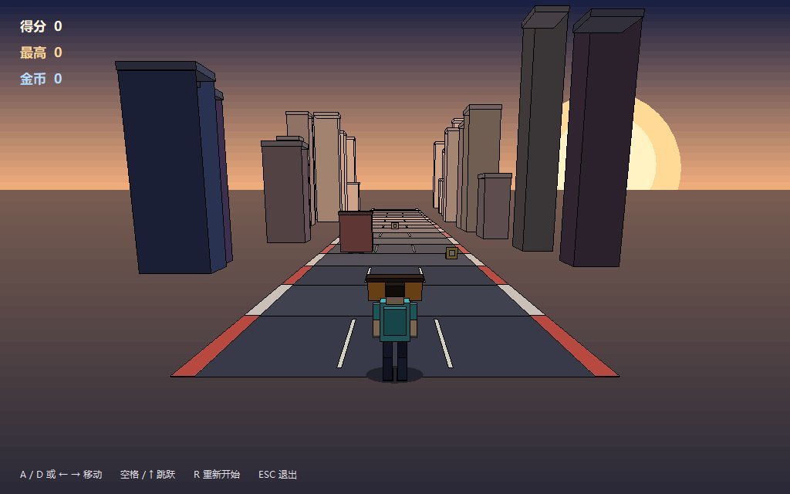

# Dusk Runner 3D

> 一个只用 **851 行 C 代码**写成的第三人称 3D 跑酷：没有引擎、没有第三方库、没有一个图片或音频文件。
> 所有画面由 Win32 GDI 逐多边形软件渲染，所有音效在启动时用正弦波合成。



黄昏的城市天际线、三车道高架、跑步摆臂的角色、会追上来的速度——全部由代码现场算出来。

---

## 特性

- **零依赖**：只链接 `user32` / `gdi32`，`winmm` 也是运行时 `LoadLibrary` 动态取的，缺了游戏照跑，只是没声音。
- **零资源文件**：建筑、角色、金币、路面的几何体全部由代码生成；音效是三段合成波形（跳跃啁啾、金币双音、撞击低频嗡鸣）。
- **自研软件渲染管线**：向量运算 → 世界坐标 → 相机变换 → 透视投影 → 背面剔除 → 画家算法排序 → GDI `Polygon` 填充。
- **单文件**：`runner3d.c` 一个文件装下数学库、渲染器、音频合成、游戏逻辑、窗口过程。
- **45 KB 的可执行文件**：比一张手机照片还小。

## 玩法

| 按键 | 动作 |
| --- | --- |
| `A` / `←` | 向左移动 |
| `D` / `→` | 向右移动 |
| `Space` / `↑` | 跳跃 |
| `R` | 重新开始 |
| `Esc` | 退出 |

- 三条车道，橙色**栏架**要跳过去，暗红色**高墙**只能左右躲开。
- 吃金币 **+50 分**，距离本身也计分（`得分 = 距离 × 4 + 金币 × 50`）。
- 速度随距离线性增长（`0.20 → 0.48`），跑得越远，反应窗口越窄。
- 最高分保存在 exe 同目录的 `runner3d_best.txt` 里。

## 快速开始

**直接玩**：下载 `runner3d.exe` 双击即可。Windows 10/11 自带所需运行库，无需安装。

> 首次运行若被 SmartScreen 拦下，选「更多信息 → 仍要运行」——这是未签名自制程序的正常提示。

**自己编译**（源码只有一个文件）：

```bash
# TCC（最小、最快）
tcc runner3d.c -lgdi32 -luser32 -Wl,-subsystem=windows -o runner3d.exe

# MSVC
cl /nologo /utf-8 runner3d.c user32.lib gdi32.lib /link /SUBSYSTEM:WINDOWS

# MinGW-w64
gcc runner3d.c -lgdi32 -luser32 -lwinmm -mwindows -O2 -o runner3d.exe
```

**生成一张静态截图**（不需要开窗口，直接渲染一帧存 BMP）：

```bash
gcc -DPREVIEW runner3d.c -lgdi32 -luser32 -o preview.exe && ./preview.exe
# 输出 preview.bmp
```

## 技术实现

### 渲染管线

没有 GPU、没有 Direct3D，全部在 CPU 上算完再交给 GDI 画多边形。一帧的路径是：

1. `setupCamera()` 由角色位置推出相机基向量（前 / 右 / 上）——第三人称跟随，略带俯角。
2. 每个立方体的 6 个面经 `addFace()` 做三件事：算法线、**背面剔除**（`dot(normal, camPos - centroid) <= 0` 直接丢弃）、四点透视投影。
3. 投影后取四顶点深度均值作为排序键，`qsort` 按**由远及近**排序（画家算法），逐个 `Polygon()` 填充。
4. 着色与雾：`shadeFog()` 用固定光源 `(0.40, 0.86, 0.32)` 做 Lambert 明暗，再按深度向地平线暖色 `RGB(238,188,150)` 插值——这就是"黄昏"的来源。

受限于画家算法，**相互穿插的几何体会出现排序错误**，所以所有物体都做成规整立方体、且不互相穿透。

### 场景构造

| 元素 | 做法 |
| --- | --- |
| 路面 | 沿 Z 轴切成 4 单位长的段，逐段画四边形，奇偶段换色形成流动感 |
| 路缘 / 车道线 | 同段错位绘制，虚线段只在偶数段画 |
| 建筑 | 26 个立方体，跑过身后就重新随机（高度 4.0–13.0、宽深随机），始终有"城市在后退"的错觉 |
| 角色 | 由 10 余个立方体拼成：大腿 + 小腿两段式肢体，用 `sin(phase)` 驱动摆臂摆腿；起跳时切换到固定姿势 |
| 阴影 | 把椭圆压扁贴在地面投影点上，半径随距离缩放 |

### 声音

启动时 `buildSounds()` 直接拼出 WAV 的 RIFF 头 + PCM 采样（22050 Hz / 16 bit / 单声道），再以 `SND_MEMORY` 交给 `PlaySoundA` 播放。三段音效分别是：

- 跳跃：480 → 1980 Hz 的上滑啁啾，指数衰减包络
- 金币：1050 Hz / 1560 Hz 两段短音，带二次谐波
- 撞击：220 → 70 Hz 下滑的低频，叠了半频分量

### 一些实现细节

- **UTF-8 中文**：TCC 的精简 winapi 缺 `winnls.h`，所以自己声明了 `MultiByteToWideChar`，界面文字统一走 `TextOutW` / `DrawTextW`，字体用「微软雅黑」。
- **双缓冲**：内存 DC + `CreateCompatibleBitmap`，每帧 `BitBlt` 到窗口，`WM_ERASEBKGND` 直接返回 1 防闪烁。
- **帧率**：主循环 `Sleep(16)` ≈ 60 FPS，**没有 delta-time**——所有速度、重力都按"每帧"写死，所以掉帧会让游戏变慢（这是刻意的简化）。

## 代码结构

单文件，按区块划分：

| 区块 | 大致行号 | 内容 |
| --- | --- | --- |
| 配置 | 31–41 | 窗口尺寸、焦距、赛道宽度、车道宽、远裁剪面 |
| 数学 | 43–57 | `V3` 向量与加/减/点/叉/归一化 |
| 颜色 | 59–69 | 钳位、缩放、线性插值 |
| 相机与投影 | 71–95 | `setupCamera()` / `project()` |
| 多边形缓冲 | 97–181 | 面片收集、雾与明暗、立方体、深度排序 |
| 文字 | 183–205 | UTF-8 → 宽字符封装、矩形/椭圆填充 |
| 音频 | 207–287 | WAV 合成与 `PlaySoundA` 动态绑定 |
| 游戏状态 | 289–344 | 障碍 / 金币 / 建筑数组、最高分读写、场景初始化 |
| 角色 | 346–402 | 两段式肢体与跑步姿势 |
| 世界绘制 | 404–508 | 天空与地面渐变、赛道、阴影、物体装配 |
| 更新逻辑 | 510–600 | 生成、移动、碰撞判定、难度递增 |
| HUD 与结算 | 602–640 | 得分面板、撞击结算页 |
| 渲染与窗口 | 642–770 | 帧组装、`WndProc`、`WinMain` |
| 预览模式 | 772–851 | `-DPREVIEW` 下的离屏出图 |

## 调参

改文件顶部的宏就能改手感，不需要动逻辑：

| 宏 | 默认 | 作用 |
| --- | --- | --- |
| `WIN_W` / `WIN_H` | `1024` / `640` | 画布尺寸（改完窗口自适应，不是可缩放窗口） |
| `FOCAL` | `560.0` | 焦距，越小视野越广（透视越夸张） |
| `ZFAR` | `70.0` | 远裁剪面，决定能看多远 |
| `TRACK_HALF` | `4.2` | 赛道半宽，直接决定三条车道的总宽 |
| `LANE_W` | `2.2` | 车道间距 |
| `MAX_OB` / `MAX_COIN` / `MAX_BLD` | `12` / `24` / `26` | 各类实体上限，调大更热闹也更吃 CPU |

想改难度，看 `update()` 里这两行：

```c
g_speed = 0.20 + g_dist * 0.00055;   // 起步速度 + 随距离的加速度
if (g_speed > 0.48) g_speed = 0.48;  // 速度上限
```

## 已知限制

- **仅 Windows**：Win32 + GDI 是硬依赖，没有跨平台抽象层。
- **固定窗口**：1024×640 不可拉伸，`CS_HREDRAW` 重建的是同一尺寸。
- **无 delta-time**：帧率与游戏速度绑定，掉帧即变慢。
- **画家算法的代价**：不支持互相穿插或凹多边形，所以场景里全是轴对齐立方体。
- **无 MSAA**：多边形边缘有锯齿，靠 GDI 的抗锯齿字体掩盖了一部分。

## License

未指定。若要复用、修改或分发，请先联系仓库作者。
